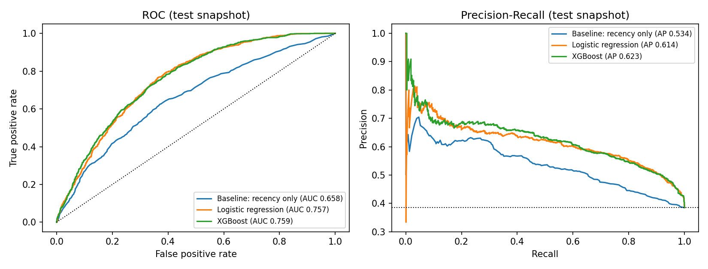
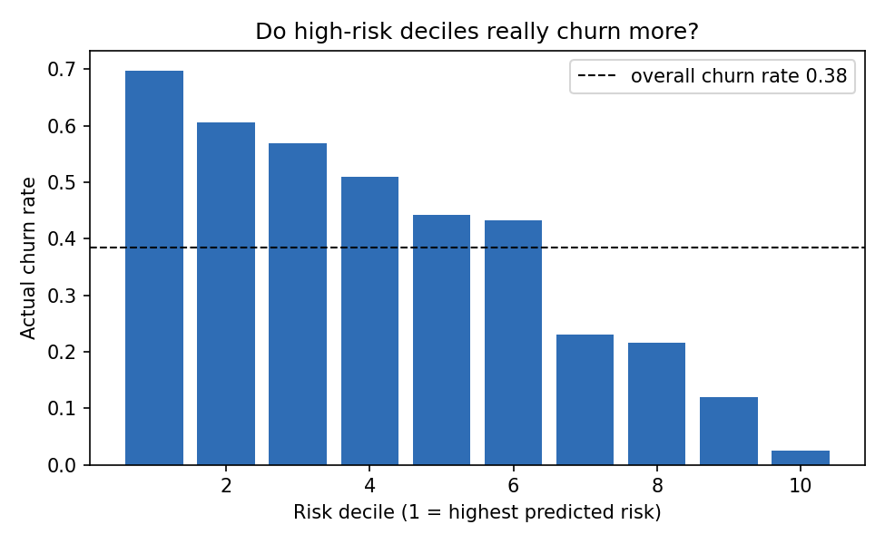
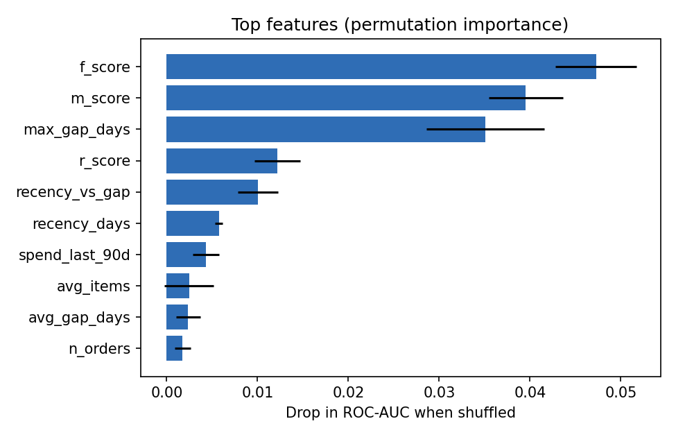

# 🛒 Customer Churn Prediction — Online Retail Analytics

> **End-to-end ML pipeline** that predicts which active customers of a UK-based online retailer will **not purchase again within 90 days**, enabling targeted retention campaigns that reach **35% of at-risk customers by contacting only the top 20%** — a **1.73× lift** over random outreach.

Built with **SQL** (CTEs, window functions), **Python**, **Pandas**, **scikit-learn**, and **XGBoost** on the [UCI Online Retail II](https://archive.ics.uci.edu/dataset/502/online+retail+ii) dataset (~1.07M transactions, Dec 2009–Dec 2011).

---

## 📌 Business Problem

Acquiring a new customer costs more than retaining an existing one. For an online retailer with thousands of active accounts, the question is:

> *Which customers are most likely to lapse in the next 90 days, and how should a retention campaign be prioritized so it reaches the most at-risk customers first?*

This project answers that by building a **churn propensity model** that scores every active customer, ranks them by risk, and provides actionable decile-level targeting recommendations.

---

## 🏗️ Architecture & Pipeline

```
┌─────────────────┐     ┌──────────────────┐     ┌──────────────────┐
│   Raw Excel     │────▶│  Data Cleaning   │────▶│   SQLite DB      │
│  (1.07M rows)   │     │  (Pandas)        │     │  (794K clean)    │
└─────────────────┘     └──────────────────┘     └──────────────────┘
                                                          │
                              ┌────────────────────────────┘
                              ▼
                   ┌──────────────────────┐
                   │  Feature Engineering │
                   │  (SQL: CTEs, Window  │
                   │   Functions, NTILE)  │
                   └──────────┬───────────┘
                              │
              ┌───────────────┼───────────────┐
              ▼               ▼               ▼
       ┌────────────┐  ┌───────────┐  ┌────────────┐
       │  Recency   │  │  Logistic │  │  XGBoost*  │    *XGBoost edges out logistic regression by only 0.002 ROC-AUC — a gap that may not be statistically significant, suggesting the simpler model        |            |  |           |  |            |     is a viable production choice where interpretability matters
       │  Baseline  │  │ Regression│  │  (best)    │
       └────────────┘  └───────────┘  └────────────┘
              │               │               │
              └───────────────┼───────────────┘
                              ▼
                   ┌──────────────────────┐
                   │  Evaluation & Output │
                   │  ROC/PR curves,      │
                   │  decile tables, lift │
                   └──────────────────────┘
```

---

## 📊 Key Results

### Model Comparison (Test Snapshot — Sept 2011)

| Model | ROC-AUC | PR-AUC | Brier Score | Precision@Top20% | Recall@Top20% | Lift@Top20% |
|:------|:-------:|:------:|:-----------:|:-----------------:|:-------------:|:-----------:|
| Baseline (recency only) | 0.658 | 0.534 | — | 0.604 | 0.314 | 1.57× |
| Logistic Regression | 0.757 | 0.614 | 0.235 | 0.645 | 0.335 | 1.68× |
| **XGBoost** | **0.759** | **0.623** | **0.236** | **0.665** | **0.346** | **1.73×** |

### Business Impact

- **Targeting the top 20%** of at-risk customers captures **35% of all churners** — 1.73× better than random outreach
- The **two highest-risk deciles** contain **35% of all churners** with churn rates of 66.5% and 66.4% (vs. 38.5% base rate)
- **Top features**: purchase frequency score, monetary score, max inter-purchase gap — indicating that buying rhythm disruption is the strongest churn signal

### Visualizations

<p align="center">
  
</p>
<p align="center"><em>ROC and Precision-Recall curves: XGBoost and Logistic Regression both significantly outperform the recency-only baseline</em></p>

<p align="center">
  
</p>
<p align="center"><em>Churn rate by predicted risk decile — the model separates high-risk (66%) from low-risk (1%) customers effectively</em></p>

<p align="center">
  
</p>
<p align="center"><em>Permutation importance: frequency, monetary and gap-based features dominate</em></p>

---

## 🧠 Technical Approach

### 1. Data Cleaning (Pandas)
- Merged two overlapping Excel sheets, removed **34K exact duplicates**
- Dropped **235K rows** with missing customer IDs
- Filtered non-product stock codes (postage, fees), zero/negative prices, invalid quantities
- Tagged credit-note invoices (starting with "C") as returns
- **Result**: 794,163 clean transaction lines from 1,067,371 raw rows

### 2. Feature Engineering (SQL — CTEs & Window Functions)
The feature query in [`sql/features.sql`](sql/features.sql) uses:
- **CTEs** to build a layered computation: purchases → ordered sequences → gaps → aggregates → scores
- **`ROW_NUMBER()`** to identify each customer's most recent order
- **`LAG()`** to compute inter-purchase gaps
- **`NTILE(5)`** for RFM quintile scoring across the active population

**21 features** including:
| Category | Features |
|:---------|:---------|
| **Recency/Frequency/Monetary** | `recency_days`, `tenure_days`, `n_orders`, `monetary`, `r_score`, `f_score`, `m_score` |
| **Order patterns** | `avg_order_value`, `avg_items`, `avg_gap_days`, `max_gap_days`, `last_order_value` |
| **Trend indicators** | `orders_last_90d`, `orders_prev_90d`, `spend_last_90d`, `spend_prev_90d`, `spend_trend` |
| **Behavioral signals** | `recency_vs_gap` (overdue ratio), `is_single_order`, `return_rate`, `return_invoices` |

### 3. Leakage-Free Temporal Split
- **Training**: 4 snapshot dates (Jun 2010 – Mar 2011) → 12,233 customer-snapshot rows
- **Testing**: Sept 2011 snapshot → 2,775 customers (strictly in the future)
- Features use only data **before** each snapshot; labels look **forward** 90 days
- No customer appears in both train and test at the same time point

### 4. Models
- **Baseline**: Raw recency (days since last purchase) as a heuristic score
- **Logistic Regression**: Imputation → StandardScaler → regularized LR (interpretable benchmark)
- **XGBoost**: 300 estimators, learning_rate=0.05, max_depth=4, conservative hyperparameters (no test-set tuning)

### 5. Evaluation
- **Metrics**: ROC-AUC, PR-AUC (better for imbalanced classes), Brier score (calibration)
- **Business metrics**: Precision/Recall/Lift at top-20% (simulates a fixed-budget campaign)
- **Decile table**: validates monotonic risk separation across score bins
- **Permutation importance**: model-agnostic feature ranking on held-out data

---

## 📂 Repository Structure

```
retail-churn-prediction/
├── README.md                          # This file
├── requirements.txt                   # Python dependencies
├── .gitignore                         # Excludes raw data and generated DB
│
├── data/
│   ├── raw/                           # Place online_retail_II.xlsx here (not tracked)
│   └── processed/                     # SQLite DB generated by pipeline
│
├── sql/
│   └── features.sql                   # Feature engineering query (CTEs, window functions)
│
├── src/
│   └── churn_pipeline.py              # End-to-end pipeline: clean → SQL → train → evaluate
│
├── notebooks/
│   └── exploratory_analysis.ipynb     # EDA notebook with inline visualizations
│
├── tests/
│   └── make_synthetic_data.py         # Generate synthetic data for smoke-testing
│
└── outputs/                           # Generated artifacts
    ├── results_summary.md             # Auto-generated results report
    ├── metrics.json                   # Model metrics (ROC-AUC, PR-AUC, Brier, lift)
    ├── feature_importance.csv         # Permutation importance scores
    ├── decile_table.csv               # Risk decile breakdown
    ├── data_quality_log.csv           # Row-level cleaning audit trail
    ├── roc_pr_curves.png              # ROC and PR curve comparison
    ├── decile_churn_rate.png          # Churn rate by risk decile
    └── feature_importance.png         # Top feature importance chart
```

---

## 🚀 Quick Start

```bash
# 1. Clone and install
git clone https://github.com/yourusername/retail-churn-prediction.git
cd retail-churn-prediction
pip install -r requirements.txt

# 2. Download data
# Get online_retail_II.xlsx from https://archive.ics.uci.edu/dataset/502/online+retail+ii
# Place it in data/raw/

# 3. Run the pipeline
python src/churn_pipeline.py --data data/raw/online_retail_II.xlsx

# 4. (Optional) Smoke test with synthetic data
python tests/make_synthetic_data.py data/raw/synthetic_test.xlsx
python src/churn_pipeline.py --data data/raw/synthetic_test.xlsx
```

All outputs (metrics, figures, summary report) are written to `outputs/`.

---

## 💡 Business Recommendation

Based on the model results:

1. **Prioritize retention offers** to the top 2 risk deciles — these customers have a **66% probability of churning** (vs. 38% overall) and contacting them captures over a third of all at-risk customers
2. **Monitor purchase gap anomalies** — `max_gap_days` and `recency_vs_gap` (how overdue a customer is relative to their own buying rhythm) are strong early warning signals
3. **Measure causal impact** — deploy with a randomized holdout group to verify that the retention offer *causes* re-engagement rather than just predicting it
4. **Re-score monthly** — customer risk changes; running the model on fresh data ensures the campaign stays targeted

---

## ⚠️ Limitations

- **Single retailer, single period**: Results describe this UK gift/wholesale business during 2009–2011; generalization requires validation
- **No marketing features**: Purchase history only — no email opens, promo exposure, or browsing data
- **Fixed 90-day churn window**: Seasonal or infrequent buyers may be misclassified
- **Label distribution shift**: The churn rate dropped from 53.6% in training to 38.5% in testing, likely because the test snapshot (Sept 2011) falls closer to the holiday buying season. This
    ~15pp shift means the model was trained on a harder population than it was tested on, which may flatter test-set precision.
- **Conservative hyperparameters**: XGBoost was not tuned on the test set; proper time-series CV could improve performance
- **Propensity ≠ persuadability**: The model predicts *who will lapse*, not *who will respond to an offer*

---

## 🛠️ Tech Stack

| Category | Tools |
|:---------|:------|
| **Languages** | Python 3.10+, SQL |
| **Data Processing** | Pandas, NumPy, SQLite |
| **Machine Learning** | scikit-learn, XGBoost |
| **Visualization** | Matplotlib |
| **Data Source** | UCI Online Retail II (CC BY 4.0) |

---

## 📄 Data Source & Citation

> **This project uses the [Online Retail II](https://archive.ics.uci.edu/dataset/502/online+retail+ii) dataset from the UCI Machine Learning Repository.**
>
> The dataset contains ~1.07 million transaction records from a UK-based online retailer covering the period Dec 2009 – Dec 2011. It is freely available under the CC BY 4.0 licence.
>
> **Download**: https://archive.ics.uci.edu/dataset/502/online+retail+ii

**Citation:**  
Chen, D. (2012). *Online Retail II* [Dataset]. UCI Machine Learning Repository.  
https://doi.org/10.24432/C5CG6D — License: CC BY 4.0

---

## 📬 Contact

**Arpan** — [LinkedIn](https://www.linkedin.com/in/arpan-ghosh-b45466b0/) · [Email](mailto:19aghosh91@gmail.com)

*Built as part of a data science portfolio demonstrating end-to-end ML pipeline development for retail/e-commerce analytics.*
